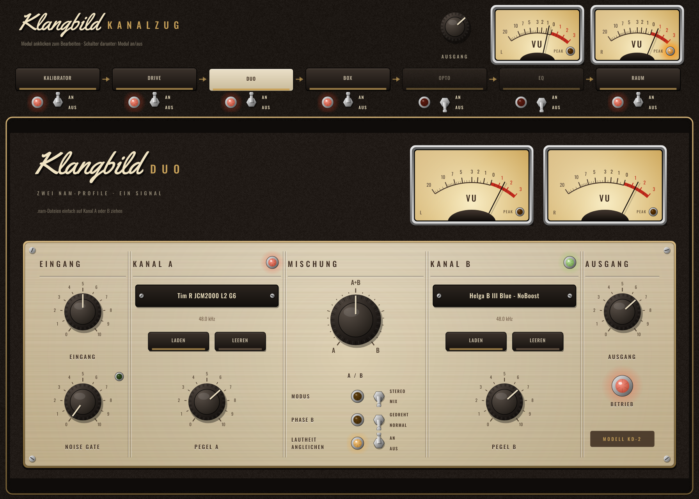
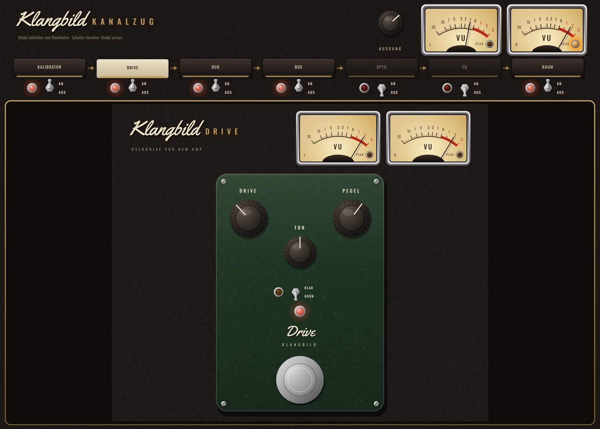

# Klangbild Kanalzug

Alle Klangbild-Plugins in **einem** Plugin – die komplette Gitarrenkette auf einer Spur,
gespeichert als ein Preset pro Sound. Dazu neu: **Klangbild Drive**, ein Overdrive vor dem Amp,
der auch einzeln als Plugin beiliegt. Audio Unit für Logic Pro (außerdem VST3 und Standalone),
gebaut mit [JUCE](https://juce.com).



## Signalweg

**Kalibrator → Drive → Duo → Box → Opto → EQ → Raum → Ausgang**

| Modul | Aufgabe |
|---|---|
| Kalibrator | Eingangspegel passend zu den NAM-Profilen |
| Drive | Overdrive/Booster vor dem Amp (neu) |
| Duo | zwei NAM-Profile mischen (Mix oder Stereo) |
| Box | zwei Boxen-IRs mit automatischem Ausrichten |
| Opto | Opto-Kompressor mit Röhrenstufe |
| EQ | 8-Band-EQ mit Analyzer |
| Raum | Doubler, Bandecho, Federhall |

- Oben auf ein Modul klicken → darunter erscheint seine vollständige Oberfläche (wie im Einzel-Plugin).
- Mit dem Kippschalter unter jedem Modul wird es an- oder ausgeschaltet. Ausgeschaltete Module
  kosten keine Rechenleistung; beim Umschalten wird kurz übergeblendet (kein Knacken).
- Standardmäßig an: Kalibrator, Duo, Box, Raum. Aus: Drive, Opto, EQ.
- **Ein Sound = ein Preset:** Über das Preset-Menü von Logic („Speichern unter …“) wird der komplette
  Kanalzug inklusive aller geladenen NAM-Profile und IRs gespeichert.
- Für Automation stehen die An/Aus-Schalter der Module und der Ausgangspegel zur Verfügung.
- Tipp für zwei Amps im Stereobild: Duo **und** Box auf *Stereo* stellen. Auf einer Mono-Spur
  den Kanalzug als **Mono → Stereo** einsetzen.

## Klangbild Drive



| Regler | Wirkung |
|---|---|
| Drive | Verzerrungsgrad |
| Ton | Höhen (GRÜN: Tiefpass 0,7–4,9 kHz · KLAR: Höhen ±8 dB) |
| Pegel | Ausgangspegel |
| GRÜN / KLAR | **Grün**: klassischer Mitten-Overdrive, die Bässe laufen sauber vorbei. **Klar**: transparenter Overdrive, sauberes und verzerrtes Signal gemischt |
| Fußschalter | an/aus (LED) |

Die Verzerrung wird 4-fach überabgetastet berechnet (weniger Aliasing). Der Drive rechnet wie
ein analoges Pedal mit Spannungen: 0 dBFS ≈ +12 dBu am Interface – zusammen mit dem Kalibrator
reagiert er auf deinen Anschlag wie ein echtes Pedal.

## Installation in Logic Pro

Tab **Actions** → letzter grüner Lauf → **Artifacts** → `Klangbild-Kanalzug-macOS`. Darin liegen
`Klangbild-Kanalzug-AU.zip` und `Klangbild-Drive-AU.zip`. Jeweils:

1. entpacken → `.component`-Datei
2. Finder → ⇧⌘G → `~/Library/Audio/Plug-Ins/Components` → hineinkopieren
3. einmal im Terminal:
   ```
   xattr -dr com.apple.quarantine ~/Library/Audio/Plug-Ins/Components/"Klangbild Kanalzug.component"
   xattr -dr com.apple.quarantine ~/Library/Audio/Plug-Ins/Components/"Klangbild Drive.component"
   ```
4. Logic starten: **Audio Units → Klangbild**

## Aufbau

| Ordner | Inhalt |
|---|---|
| `Source/` | Kanalzug: Verkettung, Überblenden, Zustand, Oberfläche |
| `Modules/` | die einzelnen Plugins als Module (Kal, Drive, Duo, Box, Opto, EQ, Raum) |
| `Shared/VintageUI.*` | gemeinsame Vintage-Oberflächenbausteine |
| `ThirdParty/` | NeuralAmpModelerCore (MIT), AudioDSPTools (MIT), Eigen (MPL2), nlohmann/json (MIT) |

## Lizenzen

Siehe `ThirdParty/` und `Resources/` (Schriften Oswald OFL 1.1, Yellowtail Apache 2.0).
JUCE: AGPLv3 bzw. kommerziell – für den privaten Gebrauch unproblematisch.
„Neural Amp Modeler“ ist ein Projekt von Steven Atkinson; dies ist ein unabhängiges Plugin, das dessen freien Code nutzt.
